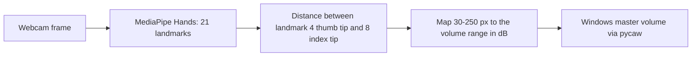

# Hand-Gesture Volume Control with OpenCV and MediaPipe

Controls the Windows master volume with a pinch: the webcam tracks your hand with MediaPipe, and the distance between your thumb tip and index fingertip sets the volume. Self-study project, April 2024, following Murtaza Hassan's (Murtaza's Workshop) hand-tracking tutorial.

This repository is a project showcase, not a maintained library.

## Demo

<a href="https://youtu.be/MM66486e3pc"></a>

[Watch the demo on YouTube](https://youtu.be/MM66486e3pc). [`VolumeControlByHandGesture.py`](VolumeControlByHandGesture.py) shows the camera feed with the hand skeleton, the thumb and index tips joined by a line, and the frame rate.

## Features

- **Hand tracking:** MediaPipe Hands finds 21 landmarks per hand in each webcam frame and draws the skeleton.
- **Reusable detector:** [`HandTrackingModule.py`](HandTrackingModule.py) wraps MediaPipe in a `handDetector` class with `findHands` (detect and draw) and `findPosition` (pixel coordinates of each landmark).
- **Pinch to set volume:** the thumb-to-index distance, from 30 to 250 pixels, is mapped linearly onto the sound card's volume range in decibels and applied through the Windows Core Audio API (`pycaw`). The midpoint dot turns black at the minimum and white at the maximum.
- **Frame rate** shown on screen.

## Installation and getting started

Prerequisites: Windows (the volume control uses the Windows Core Audio API), a webcam, and Python 3.11 (3.10 was used originally).

```bash
git clone https://github.com/naimulnashid/hand-gesture-volume-control.git
cd hand-gesture-volume-control
pip install -r requirements.txt
```

`requirements.txt` pins two packages: MediaPipe 0.10.30 and later removed the `mp.solutions` API this code uses, and later `pycaw` releases changed `AudioUtilities.GetSpeakers()`.

No releases are published: the scripts run from source.

## Configuration

No configuration needed. The camera is `cv2.VideoCapture(0)`, the first webcam; change the index to use another.

## Usage

```bash
python VolumeControlByHandGesture.py   # pinch to change the volume
python HandTracking.py                 # plain hand tracking, no volume control
python HandTrackingModule.py           # the detector class on its own
```

Stop a script with Ctrl+C in the terminal.

## Tech stack and architecture

Python, OpenCV for the camera and drawing, MediaPipe Hands for landmark detection, NumPy for the distance-to-volume mapping, and `pycaw` with `comtypes` for the Windows volume.



## Security and privacy

Frames are processed on your computer and are not saved or sent anywhere.

## Development

The project is complete and not under development. On 2026-11-22 the code was checked against current packages: the detector runs with MediaPipe 0.10.21, and the volume range reads with `pycaw` 20240210. The full webcam loop was not run.

## Credits, license and support

- The scripts follow Murtaza Hassan's (Murtaza's Workshop) hand-tracking and gesture volume-control tutorial.
- No license is granted for this repository: it is shared to show the work, not for reuse.
- This is a personal showcase, so issues and pull requests are not monitored.
